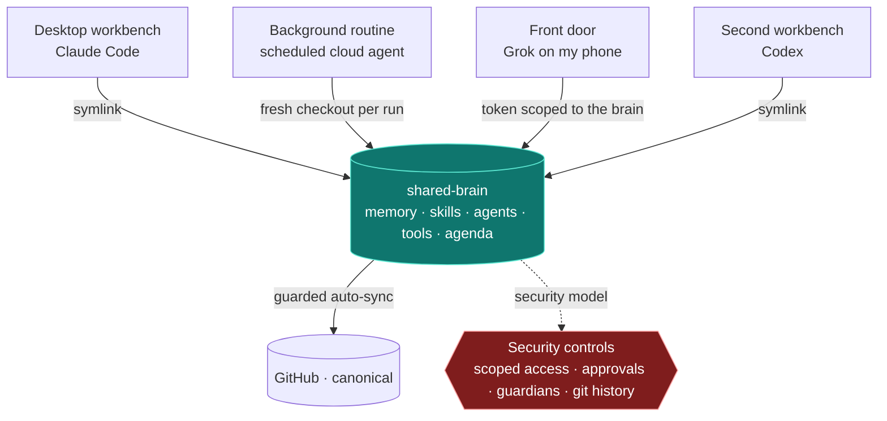

# shared-brain: one brain, many bodies

> A plain-Markdown store of memory, skills, agent definitions and working
> state that several independent agents, from different vendors, read from as
> their shared substrate, kept consistent by a guarded auto-sync, and secured
> against the failure modes of agents that read untrusted content all day.

Most agent setups put memory *inside* the agent. This one pulls it out. The
brain is a folder of Markdown files that lives on its own; the agents are
**bodies** that read it, through a symlink on my laptop or a fresh checkout in
the cloud. Change a skill or a fact once, and every body sees it: the desktop
agent, a scheduled cloud routine and the assistant on my phone alike.

This repository is a **sanitized, generalized showcase** of that substrate, the
structure, the sync model, and the security model, with all
company-, tool-, and host-specific detail removed. It's meant to be read, not
run as-is. See [Status & scope](#status--scope).

---

## The shape of it

Four bodies from three vendors, one brain. This repo is only the thing they
share; the bodies are described [below](#the-bodies).

---

## Why a shared brain instead of memory-per-agent

| Memory inside each agent | A shared brain |
| --- | --- |
| Locked to one vendor's app | Any body that can read files can join |
| Every agent relearns the same facts | Learn once, every body reads it |
| Drift between agents that should agree | One source of truth, symlinked in |
| Memory dies with the runtime | Plain files; outlives any one agent |
| No history, no rollback | Git-versioned: every change is diff-able and revertible |
| "Improve the prompt" is the only knob | Skills, agents, and facts are editable artifacts |

The leverage isn't a smarter model. It's **one inspectable substrate** that
many narrow agents stand on, with version control as the safety net underneath.

---

## What's in the brain

Five content areas, and nothing else the automation is allowed to touch:

| Area | Holds |
| --- | --- |
| `memory/` | One fact per Markdown file: who the operator is, standing feedback, project constraints, references. See [docs/memory-model.md](docs/memory-model.md) |
| `skills/` | Reusable capability definitions the bodies load on demand |
| `agents/` | The specialist sub-agent definitions |
| `tools/` | Small deterministic scripts (token-free helpers) |
| `agenda/` | Shared working state: open loops, deadlines, and the promises I made in mail or chat |

Wiring and host config live **outside** these paths on purpose: the automated
sync is never allowed to rewrite the rules it runs under.

---

## The assistant is a contract, not a product

The assistant that briefs me in the morning, takes voice notes and reminds me of
what I promised people isn't defined inside any vendor's app. It's one Markdown
file in the brain: its role, its sources, its rules, the briefing format, and
how a dictated note becomes an agenda line or a ticket. Whichever body serves as
my assistant reads that file at the start of every session.

Two details make the bodies interchangeable:

- **A front-door switch.** A small table in the contract names the one body
  that may message me. The others work in the background and only update the
  agenda. Moving the front door to another provider is a one-line change, and I
  never get the same nudge twice.
- **State lives in the brain, not in the platform.** Open loops, deadlines and
  commitments sit in `agenda/`, one line each. When a body is replaced, the
  next one picks up exactly where the last one stopped, because nothing that
  matters was ever stored only in a vendor's memory.

Today the front door is Grok on my phone and the background is a scheduled
Claude routine. The rules travel with the contract: every body drafts and asks,
none of them sends on its own.

---

## Read next

- **[ARCHITECTURE.md](ARCHITECTURE.md)**: the substrate: how bodies consume the
  brain, why "read via symlink" drives the sync model, and **Security by
  design**: how the lethal trifecta is broken structurally so prompt injection
  can't turn into data loss (also mapped to OWASP ASI 2026).
- **[docs/memory-model.md](docs/memory-model.md)**: plain-Markdown memory:
  one fact per file, an index, read-before / write-after.
- **[docs/syncing-across-hosts.md](docs/syncing-across-hosts.md)**: how the
  brain stays byte-identical across hosts, with four guardians and a heartbeat.

---

## The bodies

| Body | Role |
| --- | --- |
| **Claude Code** on my laptop | The workbench: tickets, content, documents, and conducting specialist sub-agents |
| **A scheduled Claude routine** in the cloud | The background: reads mail, calendar and chat a few times a day and keeps the agenda current |
| **Grok** | The front door: briefings, chat and voice notes on my phone |
| **Codex** | A second workbench, loading the same skills |

Two bodies have their own repos:

- **[`larry`](https://github.com/soeren90/larry)**: the orchestrator pattern, a
  conductor delegating to a fleet of narrow specialists.
- **[`hermes-agent`](https://github.com/soeren90/hermes-agent)**: an always-on
  server agent that ran scheduled operations and a chat frontend around the
  clock, in daily use from summer to autumn 2026.

None of them owns the brain. When a body is retired or replaced, the memory and
skills stay where they are. That has happened twice now: the always-on server
agent was replaced by locally running agents for security reasons, and the
assistant on my phone moved to another vendor. Both times the brain moved over
unchanged.

---

## Status & scope

This is a **showcase**, not a product. The real brain backs private mailboxes,
calendars, and operational data; everything here is generalized and stripped of
company-, tool-, and host-specific detail. There's no install path because the
value is the **architecture and the patterns**, not a turnkey binary.

Built on [Claude Code](https://claude.com/claude-code), with Grok and Codex
reading the same files.

Shared for reference, not licensed for reuse.
