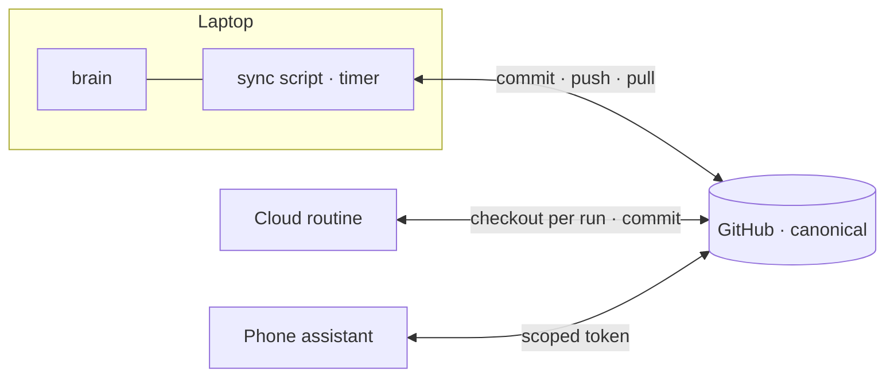

# Syncing across hosts

The brain is only useful if every body sees the *same* one. But the bodies
don't live in one place: two workbenches run on my laptop, a scheduled routine
runs in the cloud, the assistant on my phone runs on its vendor's platform, and
GitHub holds the canonical copy. Many readers and writers, one brain. They have
to agree continuously, without anyone remembering to `git push`.

This is the plumbing that lets "just a folder of Markdown files" survive being
edited from several bodies at once.

## The problem with "just commit it"

The local bodies read the brain through a symlink into their working directory.
A change written there is therefore **live immediately**, long before anyone
commits it. So a manual "review before push" gate protects nothing: by the time
you'd review, the change is already shaping the agent's behavior. All the gate
does is delay the change reaching the *other* bodies.

So the model is inverted: **distribute automatically, review after, with a
one-command undo in every notification.** Review moves from "before, if I
remember" to "after, guaranteed."

## The shape of it

On the laptop, a small, dependency-free script runs on a timer (about every 15
minutes). It stages changes under the brain, commits them with a generated
message, pushes, and fast-forwards anything the remote bodies wrote in the
meantime. No manual git in the loop.

The remote bodies never keep a copy of their own. Each run starts from the
canonical repository and writes back to it, so whatever they learn lands in
the same history as everything else, attributed to the body that wrote it.

## Four guardians

The script is not a blind `git add -A && git push`. Four checks each **halt and
notify** instead of pushing, so an automated loop can never quietly do
something irreversible:

| Guardian | Guards against |
| --- | --- |
| **Secret scan** | A credential or token accidentally written into a note. This makes the "no secrets in the brain" rule *enforceable*, not just written down. `.gitignore` catches filenames; it does not catch a token pasted mid-file |
| **Scope guard** | Anything outside the content paths (`memory/`, `skills/`, `agents/`, `tools/`, `agenda/`). An agent that rewrites its own wiring or config is changing the rules it runs under (see Security by design in [ARCHITECTURE.md](../ARCHITECTURE.md)) |
| **Remote pinning** | A bent-back `origin` remote, or a branch that isn't the main one: an exfiltration path, caught *before* any commit, not after |
| **Size brake** | An unusually large diff (many files, or a big deletion) is handed to a human. Overwriting instead of appending belongs in front of a person |

On a real divergence, where two bodies changed the same thing, the rebase is
**aborted, never guessed**. The operator gets a message with the reason and a
revert command; nothing moves until it's resolved. Resolving it automatically
would mean deciding which version of the brain is the true one.

## Why the script lives outside the brain

The sync script is deliberately **not** in the repo it syncs. It sits in host
config, next to a deploy key that can push to this one repository and nothing
else. The reasoning is blast radius: the agents write *notes*, the host
*publishes* them, and the rules for what gets published are not part of what
gets published.

## Observability

A silent automation is a liability: if it dies, you find out when the brain has
already gone stale. So every run leaves a trace. The log gets a **heartbeat**,
one timestamped line per run even when there's nothing to sync, so a gap in the
heartbeat is a dead daemon, visible at a glance. And because every body commits
under its own name, `git log` answers "who changed this, and when?" for the
whole system.

## Why this holds up

- **No lost edits.** A change from any body reaches the others within a cycle,
  automatically.
- **Nothing irreversible.** Every guardian halts rather than forces; every
  notification carries an undo.
- **Small blast radius.** The publish key lives with the host, not the agent,
  and reaches one repository.
- **Never silent.** Heartbeat and history make a stall or a surprise visible
  before it turns into stale memory.

The point isn't the sync itself. It's that a plain-Markdown brain can be
**shared across machines, clouds and vendors** without a database, without
manual git, and without ever letting an automated loop do something you can't
undo.
